# How to make an AI video on PicFix.AI

Turn a sentence, or a photo, into a short video. AI Video lives in the same editor as the image tools, so it works the way you already know: pick a model on the left, describe what you want, and press generate. You see the credit price **before** you generate.

**What you need:** a PicFix.AI account and credits on your plan. Credits are only taken when you start a video.

---

## Step 1: Open AI Video

Choose **AI Video** from the **Select Model** list at the top of the left panel. You can also reach it from the **AI Studio** menu (**AI Video Generator**) or the footer link.

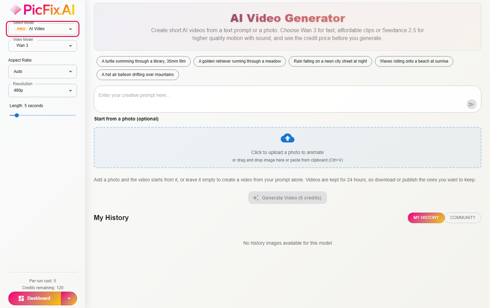

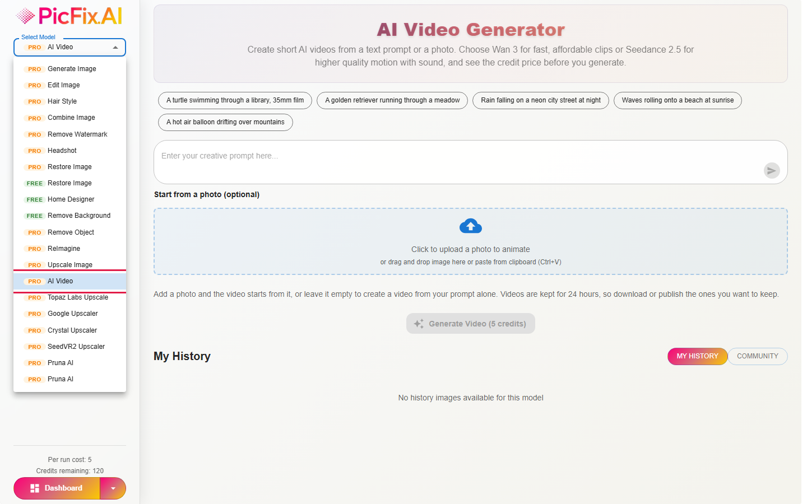

## Step 2: Choose a video model

Use **Video Model** to pick how your video is made.

- **Wan 3**: fast and affordable. Best for quick drafts and social clips.
- **Seedance 2.5**: higher-quality motion, with sound.

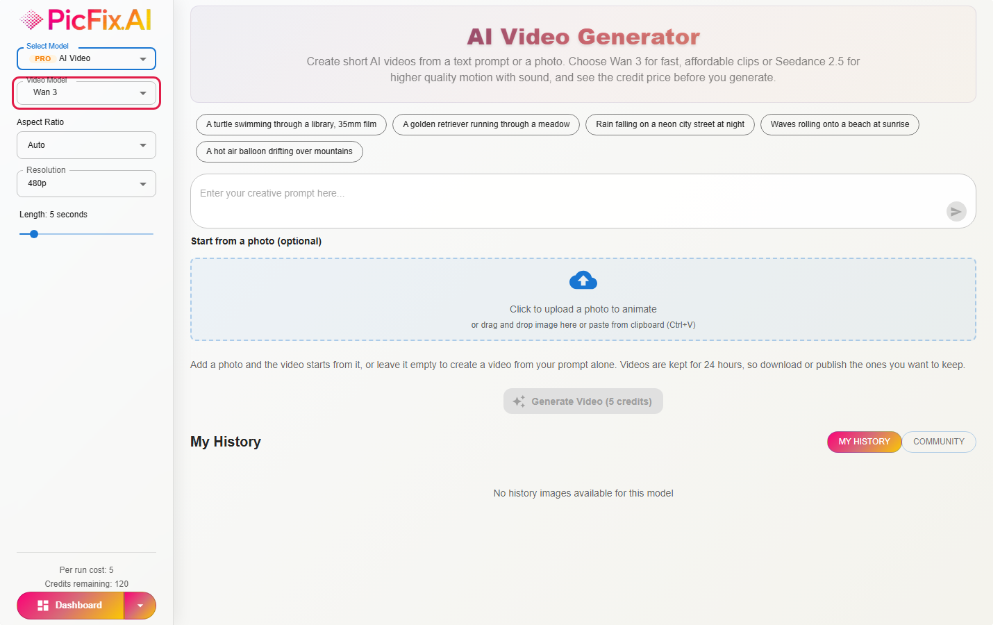

## Step 3: Describe your video

Type what you want to see in the prompt box, or click one of the example prompts above it. Say who or what is in the scene, what happens, and the look you want.

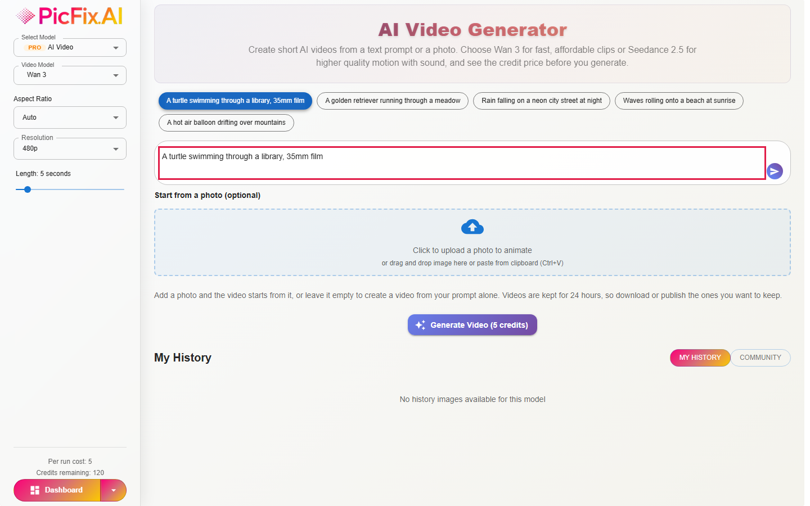

Tips for better videos:

- Describe the camera and the light, for example "slow motion, warm afternoon light".
- Keep it to one scene. Short, clear prompts work best.
- With Seedance 2.5, put spoken words in double quotes and they will be spoken in the video.

## Step 4: Start from a photo (optional)

Want your own photo to come alive? Click the upload area and choose a JPG, PNG or WebP image up to 10MB. The video starts from your photo, and its shape follows your photo. Leave it empty to make a video from your prompt alone.

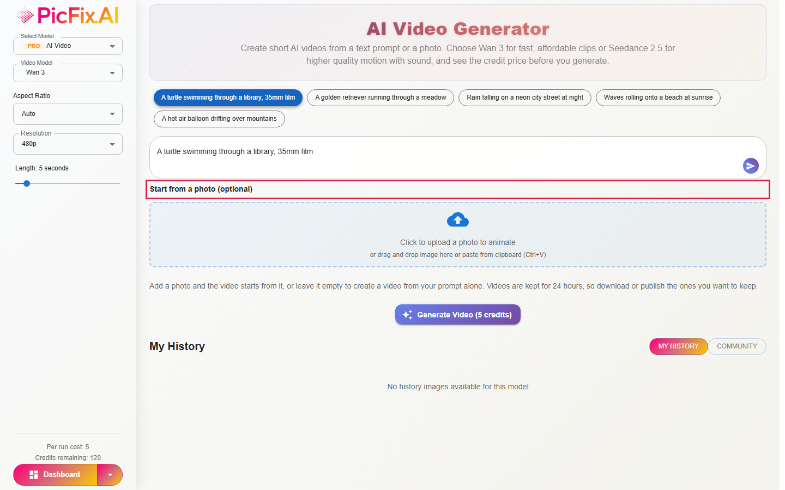

## Step 5: Set the shape, quality and length

In the left panel:

- **Aspect Ratio:** the shape of the video, such as wide (16:9) or tall (9:16). **Auto** lets the model choose.
- **Resolution:** 480p is the quickest and uses the fewest credits. Higher resolutions look sharper and cost more.
- **Length:** drag the slider. Wan 3 makes videos of 2 to 30 seconds, and Seedance 2.5 makes 4 to 30 seconds.

The price updates as you change these. It shows as **Per run cost** at the bottom of the left panel and on the **Generate Video** button. In this example, a 4-second video at 480p costs **4 credits**.

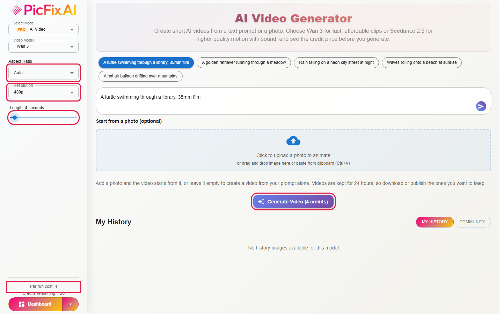

## Step 6: Generate

Click **Generate Video**. Your credits are taken, and a placeholder appears under **Generated Video** while your video is made. This can take a few minutes. You can have up to 3 videos generating at the same time.

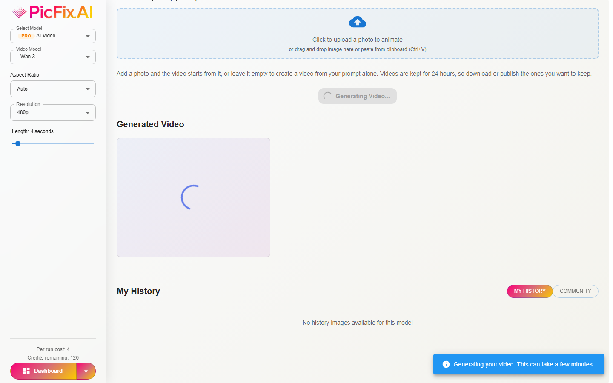

## Step 7: Watch, download or publish

When it is ready, press play. Under the video:

- the globe icon **publishes** it to the community,
- the download icon **saves** it to your device,
- the bin removes it from this view.

**Videos are kept for 24 hours**, so download any video you want to keep. A video you publish is kept permanently.

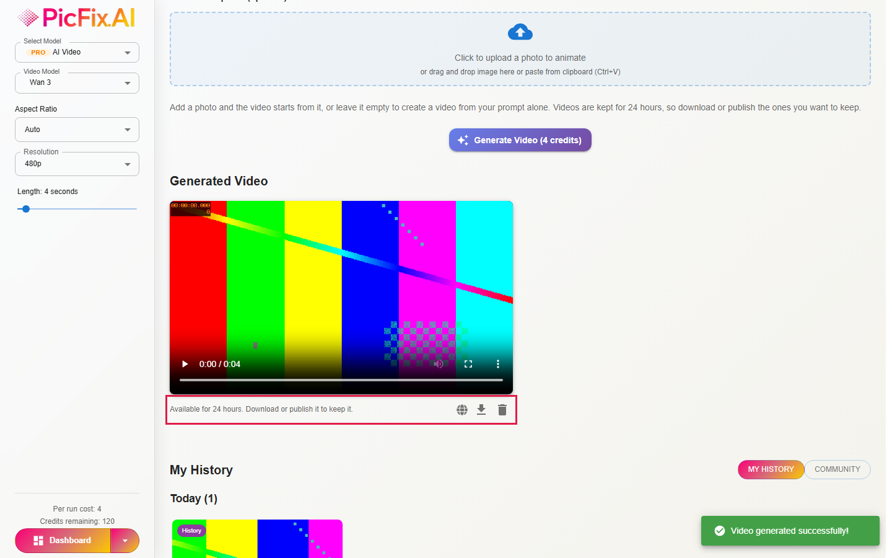

## Step 8: Find your videos later

Your videos are listed under **My History** at the bottom of the page. The **Community** tab shows videos other people have published. Videos that are not published disappear from My History after 24 hours.

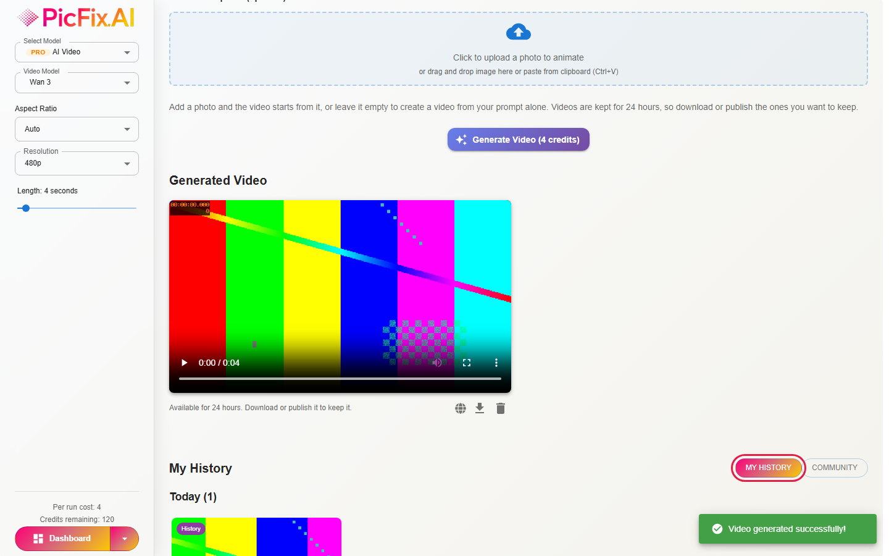

---

## Trying Seedance 2.5

Switch **Video Model** to **Seedance 2.5** to get sound with your video. The **Generate audio** switch adds music, sound effects and speech at no extra credits. Seedance costs more credits per second than Wan 3, and the price updates as soon as you switch.

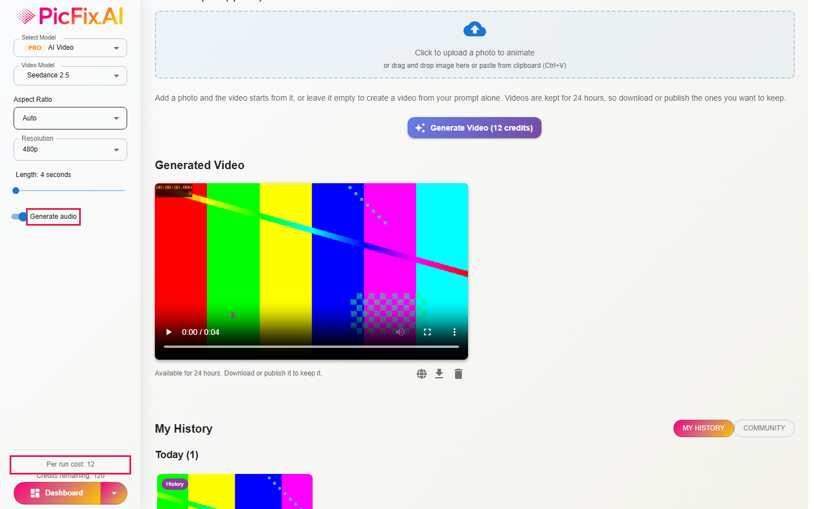

---

## If something goes wrong

**Not enough credits.** A message tells you how many credits the video needs. Upgrade your plan or buy more credits from **Pricing**. A shorter length or a lower resolution also lowers the price.

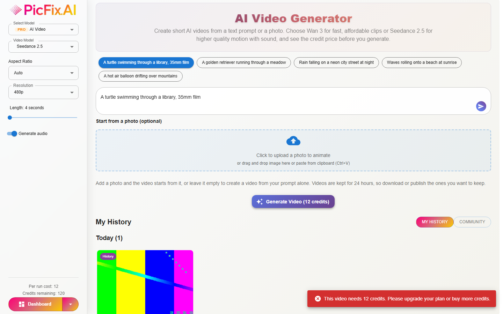

**A video could not be made.** Sometimes a video fails. **Your credits are refunded automatically**, and a message tells you so. Try again, or change your prompt.

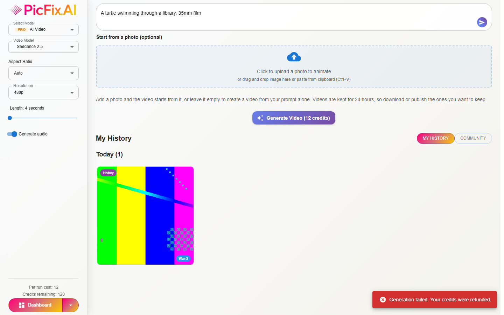

**Not signed in.** You can set everything up without an account. When you press generate, you are asked to log in, and your prompt and settings are waiting for you when you come back.

---

## On a phone

On a small screen the left panel moves to the top of the page, with the same options in the same order.

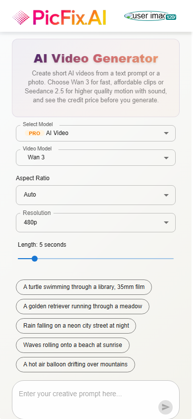

---

## Questions

**When are credits taken?** When you click **Generate Video**. The price you saw is the price you pay.

**What if my video fails?** The credits come back to your balance automatically.

**How long do my videos stay?** 24 hours, unless you publish them. After that they are deleted, so download the ones you want.

**Which model should I pick?** Start with Wan 3 at 480p to try ideas cheaply. Use Seedance 2.5 when you want sound or smoother motion.

**Why does the price change?** Longer videos, higher resolutions and Seedance 2.5 all cost more credits. The price on the page always shows what this video will cost.

---

*About these screenshots: they were taken from the real editor page, with sample data standing in for a signed-in account, a credit balance and finished videos. The clip shown as the finished video is a test pattern, not a real generated video.*
